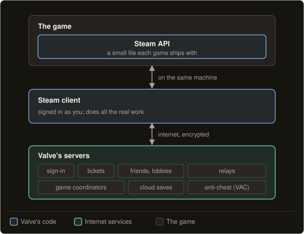
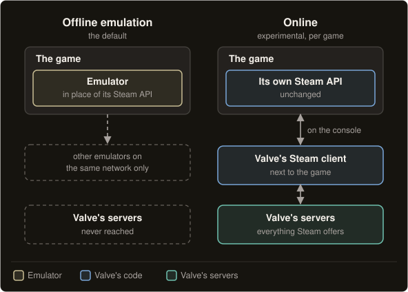
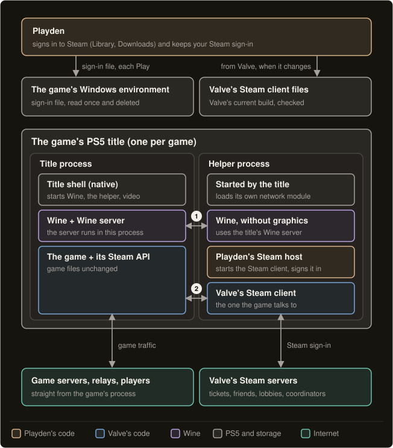

# Online play (experimental)

Online is an experimental mode that lets a Steam game on the PS5 play with other Steam players. You choose it
per game, and it is off by default. This page explains what it does, how it works on a PS5 and what can go wrong.

> [!WARNING]
> **Online is experimental.** It signs in to your real Steam account from a jailbroken console. A game with Valve
> Anti-Cheat could get your account banned from that game. Read [What can go wrong](#what-can-go-wrong) before you
> turn it on.

> [!NOTE]
> **Other anti-cheat isn't supported.** Games that use an anti-cheat other than Valve's don't work online, and
> neither do games with kernel-level anti-cheat. That includes PUBG: Battlegrounds, Apex Legends, Rust, Rainbow Six
> Siege and Call of Duty.

By default, Playden runs your games offline. They can't reach official servers, Steam lobbies or anyone outside your
local network.

Online changes that for each game you choose it for. When a game is set to Online, Playden runs Valve's own,
unmodified Steam client on the PS5, next to the game. The game talks to it as it would on a Windows PC, so every
Steam feature comes from Valve's code, not Playden's.

Because everything Steam sees comes from Valve's own Steam client, the risk to your account is about the same as
running Steam on a PC. The real risks are elsewhere: nobody knows yet how Valve Anti-Cheat reacts, and your
Steam sign-in is stored on a jailbroken console.

## Why games are offline by default

A Steam game doesn't talk to Valve by itself. It asks a Steam client that runs on the same machine, and by default
Playden doesn't run one. An emulator answers the game instead.

**On a PC, the Steam client does the work.** Every Steam game ships with a small file from Valve called the Steam
API. When the game wants something from Steam, such as your friends list or a lobby to join, it asks through that
file. The Steam API passes the request to the Steam client on the same PC, and the Steam client talks to Valve's
servers.

On a PC, the game never talks to Valve itself for Steam features. It asks the Steam client, and the Steam client does
the work.

The Steam API does very little by itself. The real logic is in the Steam client, and only Steam has it. Games that
use Steam's own networking, such as relays or peer-to-peer connections, also load part of the Steam client into the
game itself.

**Online play depends on a ticket.** Most online features rest on a ticket: a small piece of data, signed by Valve,
that says "this player is signed in to Steam and owns this game". Only Valve's servers can sign one, so only a Steam
client that is really signed in can get one. A game server uses it to check who you are:

1. The game asks the Steam client for a ticket for that server.
2. The Steam client asks Valve, and Valve signs a ticket for your account.
3. The game sends the ticket to the game server, or to another player.
4. The game server asks Valve if the ticket is real. Valve answers yes or no, and the server lets you in or kicks
   you.

The same idea comes in a few more forms:

- **Encrypted app tickets** prove that you own the game to a publisher's own online service, such as Epic Online
  Services, PlayFab or Photon.
- **Game coordinators** are Valve's servers for Valve's own games, such as Team Fortress 2, Counter-Strike and Dota.
  They handle items and matchmaking, and a game reaches them through the Steam connection.
- **Relays** carry traffic between players through Valve's network, and they need Steam's sign-in too.

**Playden's default is an emulator.** By default, Playden replaces the game's Steam API with an emulator
([gbe_fork](https://github.com/Detanup01/gbe_fork)): a stand-in that answers the game itself. It tells the game
"Steam is running, you own the game and its DLC, here are your achievements". That is ideal for playing offline.

But the emulator never reaches Valve, so it can't get a real ticket. Official servers, Steam lobbies, relays and game
coordinators all refuse it, and its multiplayer only reaches other emulators on the same local network.

## Online runs Valve's own Steam client

With Online, Playden stops answering for Steam. It runs Valve's real Steam client on the console and lets the game
talk to it.

The game keeps its original Steam API, unchanged. Valve's Steam client runs next to the game and signs in as you.
From there, the game gets whatever it offers on Steam: official servers, lobbies, relays and game coordinators.
Playden doesn't have to rebuild any part of Steam, and to Steam it looks the same as a PC.

| | Offline emulation (the default) | Online (experimental) |
| --- | --- | --- |
| The game's Steam API | Replaced by the emulator | The game's own, unchanged |
| What answers the game | The emulator, on the console | Valve's Steam client, signed in as you |
| Reaches Valve's servers | Never | Yes, as on a PC |
| Multiplayer | Other emulators on the same local network | What the game offers on Steam |

Online is set per game, and it is off by default. A game that isn't set to Online keeps using the emulator.

## How the Steam client fits on a PS5

On a PS5, a game is one running program, and the system isn't built for a game that needs two. Playden starts a
helper next to the game, and the two share one Windows "machine".

**A game on the PS5 is a single process.** A Windows game asks Windows to do things: open a file, open a network
connection, draw a window. Wine answers those calls with its own version of Windows, so the game's own program runs
unchanged on a different system. That is how Playden runs Windows games.

Wine also has a Wine server, which plays the part of the Windows kernel. It keeps the objects that Windows programs
share, such as handles, events and pipes. Every Wine program normally connects to one Wine server, and that is how
two programs see the same Windows "machine".

On the PS5, each game runs inside its own title, the PS5's word for an installed app. A title is a single process,
which means one running program, and it can't create other processes the way a PC program does. So the Wine server
runs inside the game's process, and until Online every game was exactly one process.

**Online adds a helper process.** Valve's Steam client has to run next to the game for the whole session, so Online
needs a second process. The game's title asks the PS5 to add one, and that second process is the helper. It is a path
the PS5 doesn't normally allow for games.

**1** The helper's Wine connects to the Wine server inside the title, so both processes share one Windows "machine".
**2** The game's Steam API reaches Valve's Steam client through that shared Wine server, exactly as on a PC.

## What happens when you press Play

1. **Playden hands over your Steam sign-in.** Playden keeps your Steam sign-in on the console, so it can sign in to
   Steam as you without your password. It works until it expires or you revoke it, for example when you deauthorize
   devices in Steam. When you press Play, Playden writes it to a private file in the game's Windows environment. The
   Steam host later reads that file once and deletes it. So you sign in only once, in Playden, and your sign-in never
   goes into the game's folder, which may be on an external drive where every file is readable.
2. **Playden fetches Valve's Steam client.** This happens the first time you play a game Online, and again when
   Valve publishes a newer Steam client. The download comes from Valve's servers and is about 64 MB. Playden checks
   it against the checksum in Valve's own file list, and it leaves out Valve's crash reporter. One copy on the
   console's internal storage serves every Online game. Playden never ships Valve's files itself.
3. **The game's title starts the helper.** The title starts, and Wine starts its Wine server inside the title's
   process. The title then starts the helper, gives it the title's access to the console's storage and to the Wine
   server, and holds the game back for now.
4. **The helper starts Wine without graphics.** The PS5's graphics driver can't be loaded a second time, so the
   helper's Wine runs without graphics.
5. **Playden's Steam host signs in.** The Steam host is a small open-source program that runs in the helper. It
   starts Valve's Steam client, signs it in with your Steam sign-in, and writes the registry values a game reads to
   find Steam. It waits until the Steam client knows your account owns the game, then says "ready". Valve's own
   Steam program can't do this job: it is an updater and a user interface, and neither can work here.
6. **The title releases the game.** If the Steam host fails, or 60 seconds pass, the game starts anyway, without
   Steam, and the PS5 shows "Steam didn't start: \<reason\>. The game runs without it; close the game and try
   again."
7. **The game finds the Steam client.** The game's own Steam API finds the running Steam client, as it does on
   Windows. From here everything is Valve's code: tickets, friends, lobbies, relays and game coordinators.
8. **The game ends.** The helper is part of the game's title, so it ends with it.

## What can go wrong

For games without Valve Anti-Cheat, an account ban is unlikely. For games with it, the risk is unknown.

These are judgements, not measurements.

| Risk | How likely | What would happen | Where it stands |
| --- | --- | --- | --- |
| An account ban, in a game without Valve Anti-Cheat | Unlikely | Your account loses access. | Steam sees Valve's own Steam client and the game's own Steam API, as on a PC. Valve doesn't ban for running under Wine: Proton runs Windows games that way on Linux and the Steam Deck. Playden forges nothing. Other projects already run Valve's Steam client this way, [GameNative](https://github.com/utkarshdalal/GameNative) on Android among them. |
| Valve Anti-Cheat (VAC) on protected servers | Unknown | You are kicked ("VAC unable to verify") or, at worst, get a permanent VAC ban for that game. | VAC runs inside a game on protected servers. If it detects a cheat, that account is banned from the game for good. With Online, VAC runs under the PS5's Wine, and Proton's record on Linux doesn't prove the PS5 case. Playden warns you on every game that Steam lists with VAC. |
| Someone takes your Steam sign-in from the console | Low | They can sign in to Steam as you until you revoke it. | While you play, your sign-in sits in the game's Windows environment and in the Steam client's own saved sign-in. Playden keeps both private, never serves them over its web page, and removes them, unless the game's Steam sign-in is Kept for the Home screen. On a jailbroken PS5, the usual FTP and file-manager tools let anyone on your local network open the console's files, private folders included. That isn't new: Playden's own saved sign-in can be read the same way. Mods that run in the game can read it too. |

**Things that sound risky but aren't, realistically**

- **"Valve will notice a strange client."** Everything sent to Valve comes from Valve's unmodified Steam client. At
  sign-in, the Steam client reports its system, as from any PC. Under Wine that looks like a Windows 10 PC, as with
  Steam under CrossOver or Wine.
- **"Playden distributes Valve's software."** No. The console downloads the files from Valve the first time, and
  Playden checks them against Valve's own file list.
- **"The Steam client could change or delete the game."** No. For a game in Steam's library folder, Playden tells it
  where the game is installed, so a game that asks Steam for its own folder finds it. Playden lists the game as up
  to date with automatic updates off, and game updates still come from Playden. The Steam client doesn't update
  itself either: Playden fetches Valve's newer builds when you press Play.
- **"This affects every game."** No. Online is per game, and it is off by default. A community recipe can turn it
  on for a game that needs it, and you can turn it off again in Game settings.
- **"You have to type your password on the console again."** No. The Steam host uses the Steam sign-in Playden
  already has.

## Turn it on

You choose Online per game. It needs runtime kit 0.24 or newer; with an older one, the setting says why it isn't
offered.

1. **Pick Online for a game.** Open Game settings › Online › Steam features › **Online (experimental)**. The
   Online section comes right after Game. For a game with Valve Anti-Cheat, the choice says "This game uses Valve
   Anti-Cheat (VAC). Playing it online could get your account banned from this game."
2. **Choose when the game gets your sign-in**, in Game settings › Online › Steam sign-in:
   - **At each Play** is the default. The game is online only when you start it from Playden, and your sign-in is
     removed from the game when it ends. Started from the PS5 Home screen, the game is offline.
   - **Kept for the Home screen** also puts the game online when you start it from the PS5 Home screen, but your
     sign-in stays on the console while this is on. Signing out of Steam in Playden removes it.
3. **Play.** The first time, Playden downloads Valve's Steam client (about 64 MB). The game then talks to Steam as
   on a PC.

A community recipe can set Steam features to Online for a game that only works online. Steam sign-in and Game
invites are never in a recipe: they stay your own choice.

## Friends and invites

The Steam overlay doesn't run on the PS5, so Playden and the PS5's notifications take its place:

- **A Friends tab** in Playden lists your Steam friends and what they play. Triangle switches between Appear online
  and Appear invisible, for Playden and for the next Online game.
- **Join and Invite friends**, on a game's page, start the game with a friend's lobby to join, or with friends to
  invite once the game opens a lobby.
- **Game invites**, in Game settings › Online, says what happens when a friend invites you while you play: **Ask
  with L3 + R3** (the PS5 shows the invite, and you press both sticks in within 15 seconds to join), **Join at
  once**, **Only show** or **Off**.
- **Steam sign-in notice**, in Settings › Online play, shows the Steam account an Online game signed in as when it
  starts. It is on by default.

Friends' invites reach the console, and invites from the console reach friends. A game that acts on an accepted
invite has not been seen yet.
